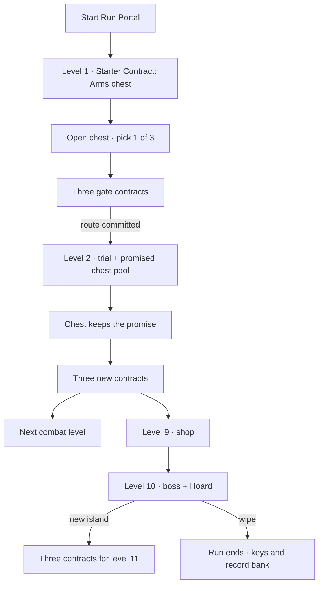

# The gate draft

**A Crab Champions-shaped run loop for Blood Champions.** Design record, not
shipped behavior. Researched 2026-11-09.

The live loop is [run.md](run.md); the upgrade pool is
[upgrade-pool.md](upgrade-pool.md). This document is the argument for changing
the decision architecture *between* those two: what a cleared level asks the
party to choose, and what the next chest is allowed to be.

> **The short version.** Blood Champions already has Crab Champions' loot — the
> 161-row pool was cut from it — but not its decision architecture. Our clear
> ends with a slot pull and a faction door. Theirs ends with a contract: a
> destination, a rule for the next fight, and a promise about the next chest,
> all visible before the party commits.

---

## 1. What Crab Champions actually does

Crab Champions is in Early Access, so numbers move. The sources below are the
official wiki current to **The Island Update** (November 2025), the Steam patch
notes, and two community guides. Where the official wiki and older guides
disagree on cadence, this document copies the **shape**, not the number.

### 1.1 The spine

| Beat | Crab Champions | Why it matters |
| --- | --- | --- |
| Lobby | Pick a primary weapon, an ability and a melee weapon; they cannot be swapped during the run. | The run starts with an identity, not a blank body. |
| Island chain | Four themed biomes (Tropical, Ice, Desert, Volcano). In the current build a biome is **seven islands**: five combat islands (the first is a fixed Arena), then the shop, then the elite/boss. | Short, self-contained arenas; the run is a sequence of small fight blocks, not a campaign. |
| Clear | Enemies die, the island's chest and up to three portals appear. | The reward and the next decision arrive together. |
| Finale | The final boss ends the arc; the player may go to Crab Island and end the run, or loop with scaling. | The run has a finish line and an endless mode on the same save. |
| Length / party | 20–40 minute runs; solo or up to four players. | Every island is a bite-sized unit, so a decision every few minutes is cheap. |

Sources: [Steam store page](https://store.steampowered.com/app/774801/Crab_Champions/),
[Biomes](https://crabchampions.wiki.gg/wiki/Biomes),
[Islands](https://crabchampions.wiki.gg/wiki/Islands),
[Looping](https://crabchampions.wiki.gg/wiki/Looping),
[The Elemental Update](https://crabchampions.wiki.gg/wiki/The_Elemental_Update),
[Fandom: Survival](https://crabchampions.fandom.com/wiki/Survival),
[Japanese Wiki: Stage](https://w.atwiki.jp/crabchampionsjp/pages/44.html).

**Version caution.** The cadence changed. The Elemental Update (September 2024)
cut a biome from eight islands to **seven**: five combat islands (the first is a
fixed Arena), then the shop, then the elite/boss. The current Japanese wiki
(updated May 2026) still describes that `5 combat → shop → elite/boss` cycle.
The English wiki's Difficulty page still describes an older ten-island biome —
shop at 9, elite/boss at 10 — and warns that its values may be out of date. The
design uses the **sequence** — combat, then shop, then wall — not the count. Our
own block is longer: eight combat levels, shop at 9, boss at 10.

If you remember “shop every five levels,” that is the current Crab biome: five
combat islands, then the shop on the sixth. The shop is not on every fifth
island globally; it is the sixth island of each seven-island biome.

Blood Champions is not changing that cadence. Its shop is level 9 of each
ten-level block (`level % 10 == 9`), so it is every ten levels — 9, 19, 29 — not
every five. A five-level shop cadence would be a separate pacing change to the
block, not a correction to Crab's structure.

**Cadence comparison.**

| | Crab Champions, current | Blood Champions |
| --- | --- | --- |
| Combat levels before the shop | 5 | 8 |
| Shop position | 6th of 7 | 9th of 10 |
| Wall | 7th (elite/boss) | 10th (boss) |
| Block | 7-island biome | 10-level run block |

The sequence is the same; the length is not. That is the whole correction.

### 1.2 The portal is the decision

After a cleared island, up to three portals spawn. Walking close reveals where
each leads; entering one is irreversible. A portal is not a random door: it
advertises the **island type / challenge** and the **reward** the next island
will pay.

| Portal family | Examples | The question it asks |
| --- | --- | --- |
| Combat island | Arena, Horde, Elite, Challenge, Demolition, Gauntlet | “What kind of fight do I want?” |
| Movement / skill island | Parkour | “Do I want a test of execution?” |
| Reward island | Damage, Health, Speed, Luck, Critical, Elemental, Economy, Relic, Spiked, Upgrade, Greed | “Which part of my build do I feed?” |
| Utility island | Shop, Anvil | “Do I spend, or do I sharpen?” |
| Random | Random portal | “Do I accept uncertainty?” |

Patch notes have reshuffled the portal pool more than once: The Anvil Update
added Anvil portals and removed Waves; The Island Update added Gauntlet. Relic,
Spiked and Upgrade portals were already in the rare pool. Treat the table as the
family, not a fixed menu. The exact UI label has moved with those patches; the
stable player-facing fact is that the portal is a package of destination, rule
and reward.

The community guide that ranks portals for a deep run ranks them **by reward
category** — Elite, Spiked, Relic, Elemental, Skill, Damage, Health, Greed,
Upgrade, Economy, Luck, Critical, Speed — which is the clearest evidence that
the portal choice is a *build choice*, not just a map choice. The French
beginner guide states it plainly: at the end of each island you choose what the
next chest will hold.

Sources: [Fandom: Portals](https://crabchampions.fandom.com/wiki/Portals),
[Islands](https://crabchampions.wiki.gg/wiki/Islands),
[The Anvil Update](https://crabchampions.wiki.gg/wiki/The_Anvil_Update),
[GameAH beginner guide](https://gameah.fr/crab-champions-les-bases-pour-debutant/),
[ano_rta portal guide, V2347](https://note.com/ano_rta/n/nd53895bc0085).

**Why it works.** A single walk-forward choice collapses three decisions that
are normally separate menus:

1. **Where** — the biome, its enemies, hazards and elite.
2. **Under what rule** — the island type, challenge modifier or blessing.
3. **For what** — the chest category, rarity bias and choice count.

The player is not choosing “the next level.” They are choosing the next
*segment of their build* and paying for it with risk. That is the loop.

### 1.3 The chest is a promise and a choice

A chest in Crab Champions is not a random item. It is a **typed surface**:

- The default chest contains **three loot choices**; the player takes one.
- The chest's type determines its pool: Damage, Health, Speed, Luck, Critical,
  Elemental, Economy, Skill, Relic, Upgrade, Greed, Spiked, etc.
- Rarity is a property of the **surface**, not a hidden roll on every row. An
  Epic chest is epic-or-better; a Legendary chest is legendary-only and appears
  on boss islands; a Greed chest shows a single greed option.
- Duplicates level the row up. The wiki notes that rows already at level 1+ have
  a higher chance to appear again, so a chest can deepen a build, not only widen
  it.
- Loot modifiers can change the chest itself: `Big Chests` / `Coral Amulet` add
  choices; `Hoarder` takes all loot but removes the ability to drop or salvage;
  `Faulty Chests` can leave unchosen cards on the ground; limited-loot rules
  remove maxed rows from the pool.
- Special chests price the reward: a Spiked chest costs a share of max health;
  an Upgrade chest only offers rows already carried; a Relic chest offers fewer
  choices; a Greed chest offers one bargain.

| Chest | Choice count | Pool / tier | Price |
| --- | ---: | --- | --- |
| Damage / Health / Speed / Luck / Critical / Elemental / Economy / Skill | 3 | that category; small epic chance | none |
| Epic | 3 | epic or higher | none |
| Legendary | 3 | legendary only | boss islands |
| Spiked | 3 | epic-tier | 25–33% of max health, depending on version |
| Upgrade | 2 | rows already carried | none |
| Relic | 2 | relic family | none |
| Greed | 1 | greed only; cannot be dropped | the row's own downside |
| Boss Legendary | 3 | legendary / epic | boss fight |

Sources: [Chests](https://crabchampions.wiki.gg/wiki/Chests),
[Rarities](https://crabchampions.wiki.gg/wiki/Rarities),
[Anvils](https://crabchampions.wiki.gg/wiki/Anvils),
[Totems](https://crabchampions.wiki.gg/wiki/Totems).

**The two-layer promise.** The portal chooses the **category** before the fight;
the chest offers the **specific rows** after it. That is the part our current
chest is missing: it rolls the row and the category at the same moment, so the
player never gets to aim the run.

### 1.4 Trials, blessings, and the risk dial

Crab Champions separates two kinds of island modifier:

- **Challenge Modifiers** make the island harder and pay an **additional
  chest**. Examples include One-Shot, Energy Rings, Shrapnel, Spike Strikes,
  Mirrored Projectiles, Homing Thorns, Barrel Rain and XL. They appear on Arena
  islands.
- **Blessings** are optional goals that pay an additional chest if completed:
  Flawless (clear without taking damage), Rush (hit a kill count), Harvest
  (capture zones), Knives Out (melee kills pay more crystals). They appear on
  Horde and Demolition islands.
- **Gauntlet** (Island Update) is the purest form: clear up to five waves,
  choosing a stacking challenge and reward modifier for each wave; cash out
  early or push for the best reward. The first wave always takes No Healing.
- **Anvil** islands add targeted Enhancement choices as the clear reward:
  three anvils, apply one to a mod you already carry. It is the “sharpen one
  thing” island, not another chest.

Sources: [Island Modifiers](https://crabchampions.wiki.gg/wiki/Island_Modifiers),
[The Island Update](https://crabchampions.wiki.gg/wiki/The_Island_Update),
[The Anvil Update](https://crabchampions.wiki.gg/wiki/The_Anvil_Update).

**Why it works.** The risk is never hidden. The player can see the modifier
before entering, and the extra chest is the price of accepting it. Failure feels
chosen, not arbitrary. That is the difference between a hard fight and a cheap
one.

### 1.5 Economy, keys, and the meta layer

- **Crystals** are the run currency. They drop from enemies and destructibles
  and are spent at the shop, the Reroll Totem and the Gamble Totem. The shop is
  an island in the sequence — you walk in, spend, and leave through a portal —
  not a menu that appears on a timer.
- **Keys** come from Key Chests after Elite or Boss fights. They persist through
  death. Three keys at the Key Totem unlock a random weapon, ability, perk or
  mod; after everything is unlocked, the totem rolls a random epic or legendary
  for the run.
- **Difficulty** is a tier plus optional modifiers; each modifier adds Challenge
  Level points. Medals are per weapon; a regular victory at island 30+ earns a
  weapon medal, and Diamond requires a level-60+ victory at Challenge Level 50.
  **Looping** raises shop prices and enemy health/count.
- The result is a run loop *inside* a meta loop: islands feed the build, the
  build feeds depth, depth feeds keys and medals, keys change the next run.

Sources: [Shop](https://crabchampions.wiki.gg/wiki/Shop),
[Crystals](https://crabchampions.wiki.gg/wiki/Crystals),
[Keys](https://crabchampions.wiki.gg/wiki/Keys),
[Totems](https://crabchampions.wiki.gg/wiki/Totems),
[Difficulty](https://crabchampions.wiki.gg/wiki/Difficulty),
[Game Mechanics](https://crabchampions.wiki.gg/wiki/Game_Mechanics).

### 1.6 The actual fun, in one table

| Driver | What Crab Champions does | What it produces |
| --- | --- | --- |
| Agency | Portal = island + modifier + reward category | Every clear ends with a choice that changes the next fight and the next build. |
| Compounding | Duplicates level rows; typed chests target a family | A run develops an identity instead of accumulating noise. |
| Priced risk | Challenge modifiers / Spiked / Greed / Elite | The player authors their own difficulty and their own reward. |
| Short feedback | 20–40 second islands, one chest, one portal walk | The loop is fast enough to make a “bad” choice cheap to learn from. |
| Social | Shared route, individual builds, four-player co-op | The party argues about the door; each body builds its own answer. |

**What not to copy.** The guns, the third-person movement, the crab comedy, the
random key unlocks, the finite four-biome run, the parkour islands. Those are
Crab Champions' body. We want its **decision architecture**, not its skin.

---

## 2. What Blood Champions does today

### 2.1 The live loop

| Beat | Current behavior | Code |
| --- | --- | --- |
| Town | Hearthstead is the lobby. The Weapon Rack binds a ranged and a melee piece; the Start Run Portal begins level 1. | `world_scene.gd`, `town_forge_panel.gd` |
| 10-level block | Levels 1–8 are waves, level 9 is a shop, level 10 is a boss. | `run_director.gd:_begin_level`, `_kind_for_level` |
| Clear | Gold, one reward chest, one upgrade pedestal, sometimes the Greed Totem and extra chests. | `_clear_level` |
| Chest | The opener gets **one random mod** (a boss's hoard gets two, one guaranteed legendary), one piece of armour, gold; the first open revives downed bodies and unseals the gates. | `_open_chest` |
| Pedestal | Every body draws its own three cards and takes one. The AI takes a random card. | `_stand_pedestal`, `_draft_for_party`, `RunPlayer.draft` |
| Gates | Three fixed gates — wood, cave, pit — all lead to the same next level; the one taken only chooses the faction/biome. | `GATES`, `_spawn_gates`, `_take_portal`, `advance_level` |
| Boss / keys | A boss pays `3 + island/2` keys; keys bank through a wipe and only the Weapon Rack spends them. | `_on_enemy_defeated`, `Roguelite` |
| Shop | Level 9 stands the stall, the rack and one pedestal; the three gates lead to the boss in the chosen biome. | `_spawn_shop_level` |

### 2.2 What is already Crab-shaped

This is not a greenfield port. The expensive parts exist:

- **The pool.** 161 rows, five families, four tiers; the tier ladder, surfaces,
  luck, max stacks, carrier tags and per-body drafts are already the Crab
  acquisition model. `docs/upgrade-pool.md` is explicit that the pool was lifted
  from Crab Champions and re-cut for our verbs.
- **The three factions.** Watchers, demons and blood clones already have
  distinct pools, blows, rates and clone kits. The “arena” choice exists as a
  faction choice.
- **The boss spine.** Every tenth level pays keys. The meta loop is already
  “boss → keys → armory,” which is close to Crab's “elite/boss → keys → unlock.”
- **The per-body draft.** The pedestal already knows how to give each connected
  player their own three offers, let a guest choose over the wire, and let an AI
  body pick at random. A chest choice can reuse this machinery.
- **The co-op contract.** The host owns levels, mobs and rolls; guests send
  requests. That is the right authority model for a party route.

### 2.3 Where the loop is thin

| Decision point | Crab Champions | Blood Champions today | Consequence |
| --- | --- | --- | --- |
| After a clear | Up to three portals; island type, modifier and reward category visible; irreversible. | Three gates; only the faction/biome differs; all pay the same chest. | The choice is a preference, not a plan. After a few blocks it is “which faction do I find least annoying?” |
| Opening the chest | Three offers from the promised category; take one. | One random row from the chest's roll; no choice. | The chest is a slot pull. The player cannot aim a build; the pedestal is the only agency. |
| Risk | Challenge modifiers, Spiked, Greed, Elite, Gauntlet; visible prices. | Elites appear automatically from wave 2; the Greed Totem is a fixed every-third-level bargain. | Risk is a background rule, not a dial the party chooses. |
| Pacing | Arena, Horde, Parkour, Challenge, Demolition, Gauntlet, Shop, Anvil. | A wave, a shop, a boss. | The objective is always “kill the queue.” |
| Meta | Keys unlock content randomly; medals per weapon; difficulty modifiers. | Keys open a deterministic catalog; one best-level record. | The long-term goal is depth only; no “I cleared that trial with that weapon” stories. |

The project's own design record already names the gap. `docs/upgrade-pool.md`
lists **“Portal choice, anvils, enhancement totems”** among the source mechanics
it dropped, with the reason: *“our portal has one exit and one press.”* This
document proposes putting the choice back, in our own shape.

---

## 3. Design pillars

**P1. The door is the draft.** A cleared level offers three complete contracts,
not three destinations. Each contract answers: *where, under what rule, for what
chest.* The party picks one; the others are gone.

**P2. The chest is a promise.** The contract names the chest's pool and tier
before the fight. Opening the chest gives every body a choice from that pool. A
player should be able to say, “I took the Swarm three levels ago because I
wanted an Arts chest,” and be right.

**P3. Risk is priced, never hidden.** A harder trial pays a visibly better
chest, more gold or more offers. The price (health, no healing, more bodies,
fog) is on the card before the commit. No surprise modifiers.

**P4. Our verbs, not their guns.** The pools are our families: shot, hand,
ability, perk, relic. Trials test guard, parry, roll, throw and positioning —
not aim-down-sights or rocket jumping. No crystals, no gun mods, no third-person
movement clone.

**P5. The town stays the meta; keys stay deterministic.** The Weapon Rack is a
catalog, not a gacha. We do not copy the Key Totem's random unlock. Mastery is
records and medals, not a second random slot machine.

**P6. Co-op shares the route, each body owns the pick.** The host takes the
gate; every connected body gets its own chest offers from the promised pool.
The AI takes a random card. The chest still revives the downed.

### 3.1 The crossing

| Crab Champions | Blood Champions | The rule |
| --- | --- | --- |
| Portal at the end of an island | Three **gate contracts** at the end of a level | Same decision point; the door is the draft. |
| Island type / challenge modifier | **Trial** (Duel, Swarm, Tithe, Fog, Spiked, Reliquary, Forge, Greed) | Same risk layer, re-cut to our verbs and our numbers. |
| Reward chest category | **Chest pool** (Arms, Arts, Body, Edge, Relic, Greed) + tier | Same promise: the category is chosen before the fight. |
| Chest: 3 choices, take 1 | Chest: 3 offers, take 1; Hoard 4, take 2 | Same shape, with our per-body offers and armour weld. |
| Four biomes, finite run then loop | Three factions, endless 10-level blocks | We keep the block, not the finite campaign. |
| Crystals and a shop island | Gold and the level-9 stall | Existing economy; no new currency. |
| Keys unlock random content | Keys open the deterministic rack | Our identity; no gacha. |
| Guns and third-person movement | Bow, blade, guard, parry, roll, throw | Our identity; no gun or movement clone. |
| Weapon mods, perks, relics | Shot, hand, ability, perk, relic | Existing 161-row pool; no new families. |

This is a clone of the **decision architecture**, not of the game. The spine,
the loot, the risk and the build steering cross. The guns, the crab, the finite
run and the random key totem do not.

---

## 4. The proposal: gate contracts

### 4.1 The loop at a glance



The 10-level spine does not change. The shop at 9 and the boss at 10 stay.
Crab's current biome is shorter — five combat islands, shop, elite/boss — but
the sequence is the same: combat, then shop, then wall. Our block is a longer
version of that sequence, with a boss every block. What changes is what stands
at the reward cluster after every other clear: three **gate contracts** instead
of three faction doors with identical pay.

**The shop gap.** If the goal is to feel like Crab's rhythm rather than only
borrow its doors, the shop cadence is the one structural mismatch left. A
10-level block cannot put a shop on level 10 — that is the boss — so “every five
levels” has to become a choice about where the extra stop goes.

| Option | Shape | Cost | Verdict |
| --- | --- | --- | --- |
| **A. Keep** | 8 combat → shop 9 → boss 10 | none | Preserves the spine and the pre-boss stop; the shop is sparse, every 10 levels. |
| **B. Mid-block market** | 4 combat → shop 5 → 3 combat → shop 9 → boss 10 | small: `SHOP_LEVELS = [5, 9]`, market stock, tests, docs | **Recommended if we want the rhythm.** Adds a shop halfway through, keeps the full pre-boss shop and boss 10. Two shops raise power, so the level-5 market should be smaller (stall + pedestal, no rack, fewer wares). |
| **C. Move the shop** | 5 combat → shop 6 → 3 combat → boss 10 | medium: shop kind, tests, economy | Matches Crab's “five combat, then shop” position, but removes the pre-boss shop; boss prep becomes weaker. |
| **D. Shorten the block** | 5 combat → shop 6 → elite/boss 7 | large: `LEVELS_PER_ISLAND`, boss cadence, keys, depth curve, tests, README | The exact current-Crab shape, but it breaks the “boss every tenth level” promise and rebalances the whole run. Not recommended unless we want a full pacing reset. |

The recommendation is **B** only if the shop cadence is part of the first cut.
If it is not, **A** is honest: the gate-contract loop works at 10 levels, and the
shop gap is a separate pacing decision. Do not do **D** just to match a number;
it changes the key economy, the depth curve and every regression that assumes a
ten-level block.

B can slide by one level. A shop at **5** is “every five” by level number (four
combat levels first); a shop at **6** is Crab's five-combat-then-shop position.
Both keep the pre-boss shop at 9. Pick by whether the level number or the combat
count is the target. Either way, the first stop should be a smaller market — the
full shop stays at 9.

### 4.2 The contract

A contract is one dictionary, host-rolled, broadcast to every machine. It is the
single source of truth for the next level's trial and chest.

```json
{
  "id": "gate_7_2",
  "next_level": 7,
  "kind": "fight",
  "biome": "caves",
  "faction": "demons",
  "trial": "swarm",
  "trial_params": { "budget_mult": 1.5, "live_cap_add": 8 },
  "chest": {
    "pool": "arts",
    "tier": "standard",
    "offers": 4,
    "picks": 1
  },
  "reward": { "gold_mult": 1.25 },
  "price": {},
  "seed": 91234
}
```

| Field | Meaning | Notes |
| --- | --- | --- |
| `kind` | `fight`, `shop`, or `boss`. | The special levels carry their own contract shape; a shop has no chest, a boss uses the Hoard chest. |
| `biome` / `faction` | The arena and its enemy table. | One of the existing three; the contract does not invent a fourth island. |
| `trial` | The rule the level is fought under. | `open`, `duel`, `swarm`, `tithe`, `fog`, `spiked`, `reliquary`, `forge`, `greed`, later `horde` / `gauntlet` / `hunt`. |
| `trial_params` | Budget, cap, HP price, healing lock, fog density. | Host-only; guests read the resolved values. |
| `chest.pool` | Which pool the chest will draw from. | `arms`, `arts`, `body`, `edge`, `relic`, `greed`; Greed is cross-cutting. |
| `chest.tier` | The surface's rules: standard, elite, spiked, upgrade, relic, greed, hoard. | Tier governs allowed rarities and offer count; it is not a second rarity. |
| `chest.offers` | How many cards are laid out. | Base 3; the offer count is shown on the card. |
| `chest.picks` | How many cards the body takes. | 1 everywhere except the Hoard, which takes 2. |
| `reward` | Gold multiplier, extra armor chance, etc. | Kept small; the chest is the main reward. |
| `price` | HP cost, healing lock, starting HP. | Always visible; never hidden. |
| `seed` | Reproducible route roll. | The host owns it. |

### 4.3 The three-card deal

At a combat clear whose next level is also a combat level, the host generates
three contracts under these rules:

1. **Distinct destinations.** The three factions are shuffled, so the party
   always chooses an arena as well as a rule. No two cards lead to the same
   biome.
2. **One safe card.** At least one contract is `open` (no combat modifier) and
   `standard` tier. “Safe” means no combat modifier, not the easiest faction;
   the faction still varies. A party that wants a normal fight can always take
   one.
3. **One trial card.** One card carries a trial with a visible price and a
   richer chest (extra offer, epic tier, extra gold).
4. **One focus card.** One card promises a pool that has not been offered in
   the last two clears. It is always `open`; its focus is the pool, not the
   rule. This keeps the route from collapsing into “always Arms” without
   creating a second trial card.
5. **No duplicate pools.** Three cards, three different pools where possible.
   The forced-draw trials (`reliquary`, `forge`, `greed`) are exempt from this
   rule because their card already fixes the pool or tier.
6. **No trials where the next door is fixed.** A gate taken at level 8 leads to
   the shop, so those three cards are shop approaches (no trial, no chest
   pool). The shop's own gates lead to the boss, so they carry the boss faction
   and the Hoard. Level 10's gates lead to the next island. Trials belong to
   combat levels 1–8 and 11+.
7. **One trial per level.** No stacking contracts in the launch version. The
   Gauntlet is the only place a trial stacks, and it is a phase-3 objective.

Because destinations are distinct, the pool you want may sit behind the faction
you would rather not fight. That tension is the point: the gate is a plan, not a
preference.

The deal is deterministic from the run seed and the level, so a reconnect does
not reroll the board. Roll it on its own route RNG (`run_seed` mixed with the
level), not the director's reward `_rng`: the board must not perturb the chest
or mob rolls when the code order changes. The host rolls; guests receive the
three payloads.

#### A worked deal, level 6

| | Gate A | Gate B | Gate C |
| --- | --- | --- | --- |
| **Destination** | THE BRIARWOOD · watchers | THE HOLLOW BENEATH · demons | THE BLOOD PIT · clones |
| **Trial** | OPEN | SWARM | DUEL |
| **The fight** | standard wave | +50% bodies, live cap +8 | one extra elite, budget ×0.9 |
| **Chest** | ARMS · 3 offers · common/epic | ARTS · 4 offers · common/epic | BODY · 3 offers · epic+ |
| **Extra** | — | +25% gold | — |
| **The ask** | “Sharpen the bow.” | “More to kill, more to take.” | “A harder body for a better piece.” |

The player can read the whole decision from the three cards. The gate's physical
door still carries the faction art; the card is the contract.

### 4.4 What the player sees

**At the gate.** The existing floating label above each gate becomes a two-line
card:

```
ARMS · OPEN                    ARTS · SWARM                 BODY · DUEL
THE BRIARWOOD                  THE HOLLOW BENEATH           THE BLOOD PIT
3 offers · common/epic         4 offers · +25% gold         3 offers · epic+
```

A proximity panel shows the three cards side by side, with the nearest gate
highlighted. The panel is the comparison; the gate is the commitment. `G` takes
the highlighted gate. Because the choice is now consequential, the first press
opens the card detail and the second press confirms (or a 0.5 s hold); the exact
input is a UX decision, not a design blocker. The gates remain sealed until the
chest is opened, as they are today.

**Which chest stands where.** The contract is the promise, so the level-to-chest
map is fixed:

| Level | The chest |
| --- | --- |
| 1 | **Starter Contract** — Arms, standard, 3 offers. There is no prior gate to promise it. |
| 2–8 | The pool/tier of the gate taken at the previous clear. |
| 9 | None; the shop and its pedestal stand instead. |
| 10 | **Hoard** — 4 offers, take 2, one guaranteed legendary. |
| 11+ | The pool/tier of the gate taken at the previous clear. |

**At the chest.** The chest opens the existing draft modal with a contract
header:

```
THE CHEST KEEPS ITS PROMISE · ARMS · 3 OFFERS
[ Broadhead · common · level 2 ]  [ Steady Draw · common ]  [ Blind Fire · common ]
```

Each body gets its own set of offers from the promised pool. The cards show the
row's current level and what the next stack does, because a duplicate is
progress, not a wasted pick. The armour pop, the gold and the revive remain
exactly as they are. If a body has maxed every legal row in the pool, that
body's share becomes gold and armour instead of an empty board.

**At the shop approach.** The gates taken at level 8 read
`SHOP · <biome> · spend, then the boss`; the shop still sells from the full
stall. The shop's own gates read `BOSS · <biome> · HOARD`; the boss is fought in
the biome chosen there. Phase 3 may add shop modifiers, but the launch version
keeps the shop as the breath before the boss.

**At the boss.** Level 10's chest is a **Hoard**: four offers, take two, one
guaranteed legendary. The boss still pays its keys. The gates after the boss
lead to the next island and resume normal contracts at level 11.

**Three layers of “augmenting” a chest.** This proposal uses the word in three
specific places, not as a new currency:

1. **The contract augments the chest before the fight** — pool, tier and offer
   count are chosen at the gate.
2. **The chest augments the build after the fight** — pick one of three (two of
   four on the Hoard); duplicates level a row.
3. **The armour augments the body** — the piece that pops from the lid can weld
   one to three mods, exactly as it does today.

That is the whole “augment” story. No new consumable, no second shop, no
enchantment menu.

**Bonus chests.** The contract governs the level's **main** reward chest. Buried
Cache, Care Package and the other extra chests still stand on the island and
still pay one random row; they are bonus, not a second promise, and they do not
unseal the gates. If we later want them to respect the contract, they can show
one card from the promised pool, but that is polish, not the launch rule. The
boss's extra chests follow the same rule; the Hoard is the main boss chest.

### 4.5 The six pools

The pool is the promise. It is intentionally narrower than “the whole 161-row
catalog,” because the point is to aim a build, not to see more rows.

| Pool | What it draws | Source rows | The build it feeds |
| --- | --- | ---: | --- |
| **Arms** | `shot` + `hand` families | 30 + 11 = 41 | The ranged hand and the melee hand: damage, draw, swing, throw. |
| **Arts** | `ability` family | 60 | Throw, roll, guard, parry and the weapon-family ability rows. |
| **Body** | `perk` rows whose dominant stats are health, armour, healing, guard, block, damage reduction or lifesteal | split of 48 (pin the census) | Surviving the fight: pool, plate, sustain, defensive verbs. |
| **Edge** | `perk` rows whose dominant stats are damage, crit, speed, luck, economy or loot | the rest of 48 (pin the census) | Killing faster and getting richer: offence, tempo, luck, gold. |
| **Relic** | `relic` family | 12 | One unique rule; rarer, fewer offers, build-defining. |
| **Greed** | every `greed`-rarity row, regardless of family | 14 | A powerful bargain with a real downside; one offer, never a spread. |

**Greed is cross-cutting.** It is not a seventh family pool: it is the one
contract that ignores the family boundary and draws the 14 greed-rarity rows
wherever they live. A greed row still has a family pool for the other chests;
the standard and elite chests exclude it by rarity. The counts above are the
catalog before that exclusion, so the implementation pins both the family census
and the greed census.

The Body/Edge split is an authoring decision, not a runtime heuristic. Add a
`pool` field to each of the 161 rows and pin the census in
`tests/roguelite_regression.gd`; a row with no pool is a catalog bug. Every row
has exactly one **family** pool; the Greed contract is the one draw that ignores
it. The current families already give Arms, Arts and Relic their boundaries;
only the 48 perks need a body/edge call.

**Carrier tags still apply.** A bow body is never offered a staff-only row just
because the Arts chest was promised. Each body rolls its own legal offers from
the pool. The promise is the pool, not the exact card.

### 4.6 Contract tiers and offer counts

| Tier | Offers | Allowed rarities | Price / rule |
| --- | ---: | --- | --- |
| **standard** | 3 | common, epic; legendary from island 4 at the existing chest weight | none |
| **elite** | 3 | epic, legendary | awarded by the Duel trial or an elite-heavy contract |
| **spiked** | 3 | epic, legendary | 25% of max health, floored at 1; locked if the body cannot pay |
| **upgrade** | 2 | the row's current tier | only rows the body already carries; no new rows |
| **relic** | 2 | the row's current tier | only the relic family |
| **greed** | 1 | greed | the row's own downside; no spread |
| **hoard** | 4, take 2 | epic, legendary, greed | boss only; one guaranteed legendary |

Starting values:

```
BASE_OFFERS        = 3
SPIKED_HP_COST     = 0.25   # of max health, cannot kill
HOARD_OFFERS       = 4
HOARD_PICKS        = 2
TITHE_START_HP     = 0.75   # health cap, not a heal, at level start
SWARM_BUDGET_MULT  = 1.50
SWARM_LIVE_CAP_ADD = 8
DUEL_BUDGET_MULT   = 0.90
TRIAL_EXTRA_OFFERS = 1
```

**Perks that change the chest.** The existing rows need a small migration:

- `coral_amulet`: “The reward chest gives one more upgrade card, not one more
  choice” becomes **+2 chest offers**, matching the source's Coral Amulet.
- `big_chests`: currently “the pedestal lays out one more card” becomes **+1
  chest offer**; the pedestal's own count stays in `pedestal_offers` if we want
  to keep that effect elsewhere.
- `faulty_chests`: extend from “a pedestal card you did not take stays on the
  ground” to **an unchosen chest offer stays on the ground**, once per stack.
  The `keep_offer` key already exists in the pool for this; the chest is where
  it becomes legible.
- `coral_amulet` / `big_chests` stack, but cap the final offer count at 6 so a
  chest cannot become a second shop.
- `hoarder` keeps its current identity (extra chest every island, one fewer
  pedestal card) and does **not** become the source's “take all” relic. Our
  greed row's bargain is already the extra chest; changing it would rewrite an
  existing build.

**Rarity rule.** Standard and elite chests no longer roll greed. Greed's
reliable sources become the **Greed contract**, the **Greed Totem**, the **boss
hoard** and the **stall** (island 2+); a relic chest can still carry a greed
relic if the relic itself is greed. This gives the Greed contract a reason to
exist and matches the source's rule that greed is a narrow door, not a random
sprinkle.
`Mods.surface_tiers` and `tier_weights` need the corresponding change; the
regression's ladder assertions must be updated deliberately.

### 4.7 The trials

Launch set (no new objective code; all reuse the existing wave queue):

| Trial | The fight | The price | The chest | Implementation |
| --- | --- | --- | --- | --- |
| **Open** | The standard wave. | none | contract pool, 3 offers, standard tier | existing |
| **Duel** | One extra elite; budget ×0.9. | a heavier body | elite tier (epic+), 3 offers | `_pick_spec(true)`, tier `elite`; floor the remaining budget at 4 |
| **Swarm** | Budget ×1.5, live cap +8. | more bodies | +1 offer, +25% gold | `wave_budget`, `_live_cap` |
| **Tithe** | Start the level with health capped at 75% of max. | health | +1 offer, +20% gold | cap at level start; no heal lock |
| **Fog** | Denser fog and shorter sight. | information | +1 offer | stage fog/lighting only; no combat math |
| **Spiked** | The standard wave. | 25% of max health, paid on open. | spiked tier (epic+), 3 offers | tier price; body locked if it cannot pay |
| **Reliquary** | Budget ×0.9. | fewer bodies | relic pool, 2 offers | pool filter; `relic` tier |
| **Forge** | Budget ×0.9. | fewer bodies | upgrade tier (owned rows, any pool), 2 offers | owned-row filter; `upgrade` tier |
| **Greed** | Standard wave, plus a guaranteed Greed Totem. | the greed row's downside | greed pool, 1 offer | existing totem + pool |

Phase-2 objectives (new state, not new maps):

| Trial | The fight | The chest | Cost |
| --- | --- | --- | --- |
| **Horde** | Survive 60 seconds; spawns keep coming; no kill-all. | +1 offer, +25% gold | timer + continuous spawn; no new geometry |
| **Gauntlet** | Three waves; choose a stacking trial/reward each wave; cash out early. | tier rises per wave; early cash-out keeps what is earned | new level state machine; the most expensive trial |
| **Hunt** | One marked elite and its escort; no chaff. | elite tier + gold | reuse the queue; mark the target |

**Trial rules.**

- A trial applies to the next level only. It is cleared when the level is
  cleared; nothing carries unless the contract says so.
- A trial never appears on a shop or boss level. The shop is the breath; the
  boss is the wall.
- A trial's chest is still the contract's pool. Most trials change the **offer
  count / tier / gold**, not the category. The forced-draw trials (`reliquary`,
  `forge`, `greed`) are the exception, and their pool or tier is on the card.
- A trial's price is shown in the card. If a body cannot pay (Spiked below 25%
  max health), the chest is locked for that body, not for the party; the rest
  can still open it.
- No trial grants keys. Keys stay boss-only. This is a deliberate difference
  from Crab Champions' elite key chests: our keys are the armory's currency, not
  a route bonus.

### 4.8 Co-op, economy, and the meta

**Co-op.**

- The host takes the gate. Guests see the same three cards and can mark a
  preference (a ping), but the host's press is the route. This follows the
  existing host-authoritative contract in `run_director.gd`.
- Every body gets its own chest offers from the promised pool. The host rolls
  every connected body's offers at the first chest open and stores them in
  `draft_offers`, exactly like the pedestal, so a guest is choosing from the
  host's board rather than rolling its own. A guest's `choose` names its own
  row. The AI takes a random offer.
- The chest still revives the downed at half health and unseals the gates. The
  first body to open can unseal; the chest remains for bodies that have not
  picked, as it does today.
- A trial that changes party state (`Tithe`, `Fog`, `Swarm`) applies to every
  body. No per-player asymmetric trials in the launch set.

**Economy.**

- Gold: unchanged base clear/kill/chest payouts; trials add a multiplier, never
  a new currency.
- Armour: unchanged; every body that opens the chest still gets a piece, and
  the piece can still weld 1–3 mods. That weld is the third layer of “augmenting
  the chest.”
- Keys: unchanged. Boss only; banked through a wipe; only the Weapon Rack
  spends them.

**Meta.**

Add a **route ledger** to `Roguelite` (the existing `user://roguelite_meta.json`
record):

```
routes:   { "arms": 12, "arts": 8, "body": 5, ... }
trials:   { "swarm": 3, "duel": 2, ... }
best_by_faction: { "wilderness": 34, "caves": 28, "arena": 22 }
deepest_trial: { "gauntlet": 27, ... }
```

This is records, not power. It gives the long-term “I did that” stories without
turning keys into a random unlock. Phase 4 can add **trial medals** (clear a
trial at depth, clear a faction at depth, clear a no-heal contract) and a small
end-of-run recap: the route, the trials, the pools, the level. That is the
Crab-shaped mastery layer our current best-level ledger lacks.

**Optional difficulty (phase 4).** A town “Blood Oath” board can add run
modifiers — e.g. `No Quarter` (no revive, +1 tier), `Sparring` (enemies +20%
speed, +1 offer), `Pauper` (shop +50%, +1 offer). Each is a visible choice and a
record, not a key multiplier. This is the Crab Challenge Level layer, reduced to
our scale; it is not required for the first pass.

---

## 5. Worked examples

### 5.1 A bow run

- Level 1 starts with the **Starter Contract: Arms, standard, 3 offers**. The
  first chest introduces the promise before the first gate asks a question.
- At the level 1 clear, the party takes **Duel** in the Briarwood for an elite
  Arms chest. The extra elite is the price; the epic bias is the pay.
- At level 2, the chest offers three shot rows. The player takes **Broadhead**
  (flat damage), not the biggest rarity. The pedestal adds a mixed card.
- At level 4, the player takes **Swarm** in the Hollow for an Arts chest with
  four offers, because the build already has flat damage and wants a verb
  upgrade (throw or guard). The extra bodies are the price.
- At level 7, the player takes an **Open Body** contract to top up health before
  the shop; level 8's gates lead to the shop; at 9 the stall sells the last
  damage piece; at 10 the Hoard pays a legendary and the boss pays keys.

The route is the build: each gate was chosen for a pool, not for the biome the
player likes best.

### 5.2 A melee/guard run

- The player takes **Arms** for hand rows and **Arts** for guard/parry rows.
- **Tithe** is attractive because the build has sustain; starting at 75% is a
  smaller cost for this body than for a glass bow.
- **Greed** is a real temptation once the build can afford the downside; the
  Greed contract's single offer is a bargain, not a spread.
- The **Duel** trial is the build's test: a heavy body that must be parried, not
  outrun.

### 5.3 Co-op

- The party sees three cards. The bow player pings Arms; the melee player pings
  Body; the host takes the compromise (or the card that serves the run's weakest
  body).
- At the chest, each body picks from the same promised pool, but its own legal
  rows. The bow player takes a shot row; the melee player takes a hand row; the
  AI takes a random row.
- The route is shared; the build is personal. That is the co-op shape the
  existing pedestal already proves works.

### 5.4 The shop and boss

The shop level is not a trial. The gates that lead to it (taken at level 8)
preview the shop; the shop's own gates preview the boss faction and the Hoard.
The party spends gold, takes the pedestal, then chooses which faction's boss to
fight. The boss is the wall; the Hoard is the payoff. After the boss, the three
gates are normal contracts again, and the next depth block begins.

---

## 6. Implementation plan

### 6.1 Phases

| Phase | What lands | Why this order |
| --- | --- | --- |
| **0. Data and labels** | Add `pool` to the 161 rows; pin the census; add `RouteContract` helpers; gate payload carries the contract; floating card copy. | The contract must be data before it is UI. |
| **1. Gate draft** | Replace `GATES` with `_gate_contracts(next_level)`; `_spawn_gates` carries the contract; `advance_level(route)` stores the active contract; `_clear_level` uses it for the chest's pool/tier; state/wire includes it. | This is the core loop change; no new combat code. |
| **1b. Shop cadence (optional)** | If the pacing is in scope, add `SHOP_LEVELS = [5, 9]` (or `[6, 9]`) and a smaller market at the first stop; update `_kind_for_level`, `_begin_level`, `_spawn_shop_level`, docs and tests. | Do this before the route board if it ships with the first cut; it changes the level sequence. |
| **2. Chest choice** | `_open_chest` builds per-body offers from the promised pool; the existing draft modal chooses one; AI auto-picks; armour/gold/revive unchanged; `coral_amulet` / `big_chests` / `faulty_chests` re-scoped. | This is the “augment” the player feels; it reuses the pedestal machinery. |
| **3. Launch trials** | Duel, Swarm, Tithe, Fog, Spiked, Reliquary, Forge, Greed; apply budget/cap/HP/fog at `_begin_level`; reset on advance. | Trials turn the contract into a risk/reward decision without new objectives. |
| **4. New objectives** | Horde, Gauntlet, Hunt; goal state in the director; cash-out UI for Gauntlet. | These are the pacing variety layer; they cost the most and should follow the proven decision loop. |
| **5. Mastery and polish** | Route ledger, trial medals, end-of-run recap, optional Blood Oath modifiers, gate/chest VFX and audio. | Meta only after the run loop is fun without it. |

**Minimum slice.** If only one cut ships, ship **Phase 1 + Phase 2** with three
launch trials (Open, Duel, Swarm). That is the spine: the gate promises a
pool/tier, the chest delivers a choice, and one trial tests the risk dial. The
other trials, objectives and meta are layers on top; do not build them before
the gate/chest pair is fun in a playtest.

### 6.2 File map

| File | Change |
| --- | --- |
| `scripts/roguelite/mod_catalog.gd` | `pool` field and six pool constants; `draft(..., pool)` filter; new surface/tier rules; offer-count helper; census assertions. |
| `scripts/roguelite/run_player.gd` | `chest_draft(contract)` per body; offer count from the contract + `chest_choices`; avoid auto-taking the row. |
| `scripts/roguelite/run_director.gd` | `_gate_contracts`, `_spawn_gates`, `_clear_level` contract, `_open_chest` offers, `choose_draft` for chests, trial application in `_begin_level`, state/wire; optional `SHOP_LEVELS` and market variant. |
| `scripts/roguelite/roguelite_props.gd` | Gate label card; chest tier glow; contract badge; no new geometry required. |
| `scripts/roguelite/roguelite_hud.gd` | Route triptych near the gates; chest modal header; contract status; reuse `open_draft`. |
| `scripts/roguelite/roguelite_stage.gd` | Fog/lighting presets for the Fog trial; no new maps. |
| `scripts/roguelite/roguelite_meta.gd` | Route ledger fields and migration defaults. |
| `tests/roguelite_regression.gd` | Contract generation, chest offers, host/guest, boss hoard, shop/boss exceptions, maxed fallback, no keys from trials. |
| `docs/run.md` | Update the live loop once the first phase lands; keep this document as the design record. |

### 6.3 State and wire

- `active_contract`: the contract for the current level; set at
  `advance_level`, included in `state` and in the chest payload.
- `gate_options`: the three contracts for the next level; carried in each gate's
  payload and re-sent in `state` for a late joiner.
- `pending_picks`: chest draft offers keyed by prop serial and peer, exactly the
  `draft_offers` shape the pedestal already uses.
- `advance_level(route: Dictionary)` replaces `advance_level(chosen_biome:
  String)`. The host passes the full route; `biome` remains inside it. The
  existing call sites and tests need the new shape; a guest's `advance` request
  is still refused.
- Generalize the draft path. `choose_draft` and `_open_draft` currently name
  the pedestal in their status lines and pass `"pedestal"` to
  `_release_if_spent`; a chest offer uses the same `draft_offers` table, so the
  release fx and the prompt must read `Props.prop_kind(prop)` instead of
  hardcoding the pedestal. That is the only structural change the chest choice
  needs beyond rolling the offers.
- The `level` broadcast carries `active_contract`; the `prop` broadcast carries
  `gate_options` per gate. A guest that joins mid-run reads the same contract
  and the same three cards.

### 6.4 Tests and acceptance

The regression should prove, not just exercise:

1. **Deal shape.** Three contracts, three distinct factions, at least one
   `open`, no duplicate pool, no trial at shop/boss.
2. **Promise.** On a combat level, the chest at level N uses the pool/tier of
   the gate taken at N-1; level 1 uses the Starter Contract; level 9 has no
   chest; level 10 uses the Hoard.
3. **Choice.** A chest offers its contract's offer count (3 base; 2 for
   relic/upgrade; 1 for greed; 4 for the Hoard) of legal rows per body; a guest
   gets its own set; a body takes its `picks` (1, or 2 on the Hoard); a further
   pick is refused; the AI takes its picks; armour and gold still land.
4. **Fallback.** A body with every legal row maxed gets gold/armour, not an
   empty modal.
5. **Trial math.** Swarm multiplies budget and cap; Duel adds the elite and
   lowers budget; Tithe caps start HP at 75%; Spiked cannot kill and locks
   below the price; Fog changes only presentation.
6. **Boss.** The Hoard offers four, takes two, contains at least one legendary,
   and pays the same keys as today.
7. **Keys.** No trial, chest or route pays keys; only a boss does.
8. **Co-op.** The host's route is the party's; a guest's gate press is refused;
   a guest's chest pick is its own.
9. **Shop cadence (if option B).** The market stands at level 5 (or 6), the
   full shop at 9, the boss at 10; the market has no Weapon Rack and a smaller
   stock; keys and boss cadence are unchanged.
10. **Existing suite.** The full `tests/roguelite_regression.gd` and
    `python tools/run_tests.py` pass with the new contract assertions.

---

## 7. Tuning and power budget

The proposal changes **quality**, not the number of mods per clear. Hold that
line.

| Per clear | Today | Proposed |
| --- | ---: | ---: |
| Chest mods | 1 random (`2` on a boss hoard) | 1 choice from 3 (boss: 2 choices from 4) |
| Pedestal mods | 1 choice from 3 per body | unchanged |
| Armour | 1 piece per opener, 0–3 welded mods | unchanged |
| Gold | base + kills + chest | base + kills + chest, × trial multiplier |
| Keys | boss only | boss only |

Because a choice from a narrow pool is stronger than a random row from the
chest's roll, the first playtest should watch for a depth jump. Guardrails:

- Standard chest: 3 offers, common/epic, legendary still the existing 4–5.5%
  chest weight from island 4 on.
- Elite/spiked: epic+ but no guaranteed legendary outside the Hoard.
- Offer count cap: 6; no chest becomes a shop.
- Trial reward is one extra offer or one tier step, not both at launch.
- If median depth rises more than one depth block against the current build,
  cut the standard offer count to 2 or drop the trial extra before touching the
  pool's rarity ladder.
- If players always take the safe card, make the safe card's pool less
  targeted (or give the trial card a second offer), not the trial card more
  raw power.

**The six-pool balance rule.** No pool is allowed to be universally best. Arms
is the damage floor; Arts is the verb ceiling; Body is the survival tax; Edge is
the tempo/luck economy; Relic is the rule-breaker; Greed is the bargain. If one
pool dominates the ledger, the fix is in the rows or the trial prices, not in
hiding the others.

---

## 8. Risks and non-goals

| Risk | Why it matters | Mitigation |
| --- | --- | --- |
| **Choice overload** | Three cards with four lines each can stall a clear. | Three cards, three lines, one detail on proximity; no nested menus. |
| **Co-op pacing** | The host can rush the gate while a guest is reading. | Party ping on the cards; a short grace period after the chest; the host still decides. |
| **Power creep** | Targeted choice is stronger than random. | Narrow pools, offer caps, no guaranteed legendary outside the Hoard, depth telemetry. |
| **Scope** | Horde/Gauntlet are new level state. | Launch phases 1–3 with existing wave code; new objectives only after the decision loop proves fun. |
| **Network drift** | A guest must see the same contract, not roll its own. | Host rolls and broadcasts the contract; guests only choose from their own offers. |
| **Identity drift** | “Crab clone” can swallow the melee/ranged, grim tone. | Pools are our families; trials test our verbs; no guns, crystals, crab comedy or third-person movement. |
| **Random unlocks** | Crab's Key Totem is a gacha. | Keys stay deterministic at the rack; mastery is records/medals. |
| **Finite run** | Crab's run has a finite biome arc. | Our run stays endless; the 10-level block is the loop; no Crab Island. |

**Non-goals for this proposal:** new biomes, new enemy families, a parkour
island, a crystal currency, a shop-island clone, a weapon-swap system, or a
replacement for the existing 161-row pool. The proposal is a routing and reward
layer over what is already built.

---

## 9. Playtest plan and success metrics

### 9.1 Scenarios

1. Solo bow, levels 1–20, no prior route knowledge.
2. Solo melee/guard, levels 1–20.
3. Two-player co-op, one bow and one melee, levels 1–30.
4. Host + AI squadmate, levels 1–20.
5. Deep run, levels 30+, with the route ledger on.

### 9.2 Questions

- Can the player explain *why* they took each gate in one sentence?
- Did the chest deliver what the gate promised? Did the player notice?
- Did the player ever take a trial they regretted — and was the regret about
  the price they saw, not a hidden rule?
- Did the route create a build identity (bow/melee/guard/ability) by level 10?
- Did co-op produce a route argument, or did one player drag the party?
- Did any pool never get picked? Did any trial never get picked?

### 9.3 Metrics and starting thresholds

| Metric | Target |
| --- | --- |
| Gate decision time | 5–15 s median; no more than 25 s at the 90th percentile |
| Safe-card rate | below 70% of clears; if above, the trial cards are not attractive enough |
| Pool diversity | all six pools picked in a 20-run sample; no pool above 35% |
| Chest choice time | 3–8 s median; players read the cards |
| Depth | median within one depth block of the current build in the first pass |
| Death attribution | trials cause deaths, but fewer than 20% of post-run interviews call the death “unfair” |
| Co-op | every connected body gets a chest pick; no body waits more than 10 s at the chest |

### 9.4 Kill criteria

If the first pass shows the safe card above 80%, or gate time above 25 s
median, or no depth/route diversity improvement, do not add phases 4–5. Reduce
the deal to two cards, keep the typed chest choice, and re-test. The chest
choice is the part most likely to be fun on its own; the gate draft is the part
most likely to be overbuilt.

---

## 10. Decisions needed

These are proposed defaults, not blockers:

| Question | Proposed default | Why |
| --- | --- | --- |
| Who takes the gate? | Host, with party pings. | Matches the existing host-authoritative contract. |
| When do the gates unseal? | After the first chest open, as today; the chest remains for late picks. | No waiting; the chest is still per-body. |
| Does the boss hoard offer a choice? | Four offers, take two, one legendary. | The boss should feel like the run's ceiling, not a slot pull. |
| What is the first chest? | Starter Contract: Arms, standard, 3 offers. | Teaches the promise before the first gate. |
| Does the shop cadence change? | Keep A (shop 9) unless the pacing is in the first cut; then B (shop 5/6 + 9, market at the first stop). | A is the current spine; B is the smallest Crab-shaped rhythm change. |
| Do trials appear at the shop? | No. | The shop is the breath; the boss is the wall. |
| Is there a fourth gate? | Not in the launch version. | Three is readable; a fourth is a later meta reward, not a baseline. |
| Do keys get a new sink? | No. | Keys stay the armory's currency; mastery is records. |
| Does greed leave standard chests? | Yes; standard/elite chests exclude it. The reliable doors are the Greed contract, the Totem, the Hoard and the stall; a relic chest can still carry a greed relic. | Gives the Greed contract an identity and matches the source's narrow door. |

---

## Sources

Crab Champions is in Early Access; the official wiki and patch notes are the
primary record, and community guides are used only for the player-facing shape
of portal choice and chest categories.

**Official wiki**
- [Chests](https://crabchampions.wiki.gg/wiki/Chests)
- [Islands](https://crabchampions.wiki.gg/wiki/Islands)
- [Island Modifiers](https://crabchampions.wiki.gg/wiki/Island_Modifiers)
- [Biomes](https://crabchampions.wiki.gg/wiki/Biomes)
- [Shop](https://crabchampions.wiki.gg/wiki/Shop)
- [Crystals](https://crabchampions.wiki.gg/wiki/Crystals)
- [Keys](https://crabchampions.wiki.gg/wiki/Keys)
- [Rarities](https://crabchampions.wiki.gg/wiki/Rarities)
- [Relics](https://crabchampions.wiki.gg/wiki/Relics)
- [Totems](https://crabchampions.wiki.gg/wiki/Totems)
- [Anvils](https://crabchampions.wiki.gg/wiki/Anvils)
- [Enhancements](https://crabchampions.wiki.gg/wiki/Enhancements)
- [Looping](https://crabchampions.wiki.gg/wiki/Looping)
- [Difficulty](https://crabchampions.wiki.gg/wiki/Difficulty)
- [Game Mechanics](https://crabchampions.wiki.gg/wiki/Game_Mechanics)
- [The Island Update](https://crabchampions.wiki.gg/wiki/The_Island_Update)
- [The Anvil Update](https://crabchampions.wiki.gg/wiki/The_Anvil_Update)
- [The Elemental Update](https://crabchampions.wiki.gg/wiki/The_Elemental_Update)

**Steam**
- [Crab Champions store page](https://store.steampowered.com/app/774801/Crab_Champions/)
- [The Island Update patch notes](https://store.steampowered.com/news/app/774801/view/637948480724140705)
- [The Elemental Update patch notes](https://store.steampowered.com/news/app/774801/view/4592070178847557110)

**Community (shape, not numbers)**
- [Fandom: Portals](https://crabchampions.fandom.com/wiki/Portals)
- [Fandom: Survival](https://crabchampions.fandom.com/wiki/Survival)
- [GameAH beginner guide](https://gameah.fr/crab-champions-les-bases-pour-debutant/)
- [ano_rta portal/build guide, V2347](https://note.com/ano_rta/n/nd53895bc0085)
- [Crab Champions Japanese Wiki: Stage](https://w.atwiki.jp/crabchampionsjp/pages/44.html)
  — current `5 combat → shop → elite/boss` structure, updated May 2026

**Blood Champions**
- [README](../README.md)
- [run.md](run.md)
- [upgrade-pool.md](upgrade-pool.md)
- `scripts/roguelite/mod_catalog.gd`, `run_director.gd`, `run_player.gd`,
  `roguelite_props.gd`, `roguelite_hud.gd`

---

## Appendix A — card copy

Short, grim, readable at a glance. The card is a promise, not a poem.

```
THE BRIARWOOD              THE HOLLOW BENEATH        THE BLOOD PIT
ARMS · OPEN                ARTS · SWARM              BODY · DUEL
3 offers · common/epic     4 offers · +25% gold      3 offers · epic+
"Sharpen the shot."        "More to kill. More to take."  "A heavier body. A better piece."
```

```
THE CHEST KEEPS ITS PROMISE · ARTS · 4 OFFERS
```

```
SPIKED · 25% OF MAX HEALTH · 3 OFFERS
```

```
HOARD · 4 OFFERS · TAKE 2 · ONE LEGENDARY
```

---

## Appendix B — contract payload

```json
{
  "id": "gate_7_2",
  "next_level": 7,
  "kind": "fight",
  "biome": "caves",
  "faction": "demons",
  "trial": "swarm",
  "trial_params": {
    "budget_mult": 1.5,
    "live_cap_add": 8
  },
  "chest": {
    "pool": "arts",
    "tier": "standard",
    "offers": 4,
    "picks": 1
  },
  "reward": {
    "gold_mult": 1.25
  },
  "price": {},
  "seed": 91234
}
```

The HUD's contract card reads `biome`/`faction`, `trial`, `trial_params`,
`chest` and `reward`. The director reads the whole dictionary. The pool is the
promise; the tier is the surface; the trial is the price.
